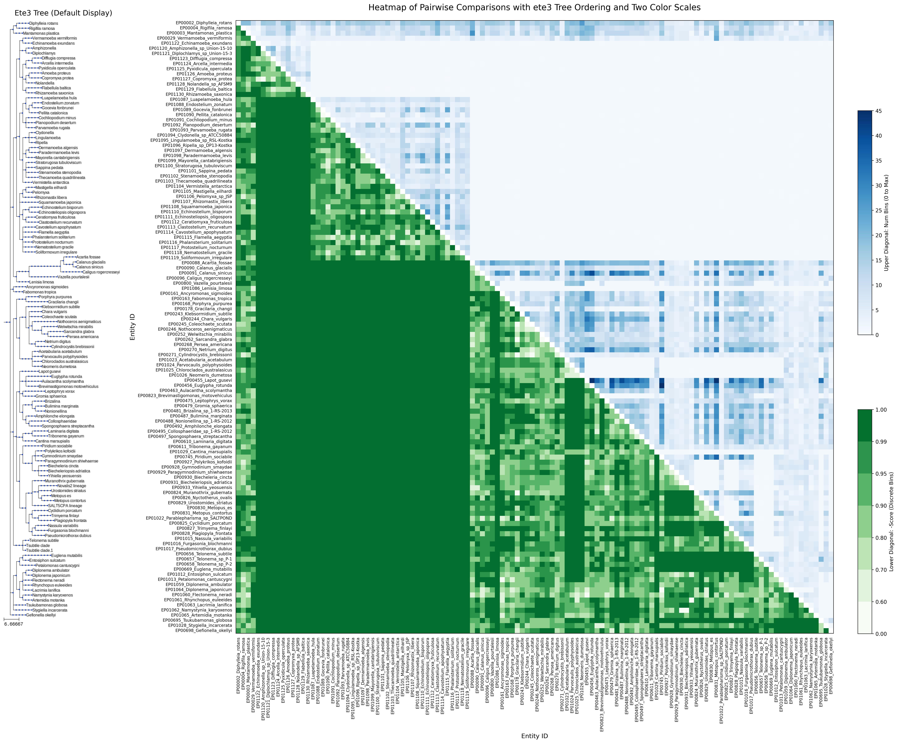

# mrnabin

Mr. Nabin is a collection of algorithms for binning mRNA
sequences. Given a FASTA file of mRNA contigs, Mr. Nabin algorithms
will bin them aiming to produce single-species bins.

## How to install mrnabin

Mr. Nabin uses [uv](https://docs.astral.sh/uv) as the project manager.

`uv sync` to install dependencies

`source .venv/bin/activate` to activate the environment

## Using mrnabin

The general use-case is for binning mRNA contigs coming from an unknown collection of species.

`uv run scripts/run_binner.py {ALGO} file contig_filepath peptide_filepath output_filepath`

The peptide file is used to correctly orient the contigs.
The output file is a TSV with two columns: contig ID and bin label (`bin_0001`, `bin_0002`, …, or `bin_none` for unbinned contigs).
In the current version, contigs without corresponding orientation information will be skipped.

Run: `uv run scripts/run_binner.py distbin file sample_data/aa_bb_contigs.fasta sample_data/aa_bb_peptides.fasta sample_output.tsv`
to see a small example run.

The other use-case is to mix together mRNA contigs coming from several different species,
and see if any of the algorithms can effectively separate them.

Run: `uv run scripts/sample_labeled_distbin_run.py` to see a small example run.

`scripts/run_binner.py` also runs every algorithm on the evaluation datasets: `a14`, and the two-organism mixtures `5686984` and `12417881`, which sweep every pair (optionally with `--parallel`) or run one chosen pair. See its docstring for details.

## Algorithms

See the README.md files for each algorithm for a more in-depth explanation of how they work.

At a high level, all the algorithms start by binning together all the
contigs that are very close to one another so that those bins are very
likely to be purely from a single species. Then the bins are
iteratively combined while trying to keep the purity as high as
possible.

### [DistBin](src/distbin/README.md)

DistBin uses the 4-mer distribution of the contigs to bin them. It is
very fast. DistBin starts by creating many bins that are extremely
likely to be from the same organism, and then iteratively combines the
bins based on their distribution distances.

### [VLP](src/vlp/README.md)

Variable Length Pattern (VLP) Clustering is a more sophisticated
method that continually rebuilds tries over the contigs in each bin.
Instead of combining bins, VLP will destroy bins that are not
well-modeled by the tries and reassign its contigs. VLP can get quite
slow as it continually rebuild tries as the bin membership changes.

### [DBV](src/dbv/README.md)

VLP seeds its bins by using a simple 4-mer clustering. DBV (DistBin +
VLP) replaces that simple clustering by DistBin, and then proceeds as
in VLP.

### [KNN](src/knn/README.md)

KNN builds a mutual k-nearest-neighbour graph over the contigs' 4-mer
distributions and partitions it with Leiden, coarsening gradually by
lowering the resolution. It produces very pure bins, but hundreds of
them per mixture. DistBin compares distances to constants, and no
constant can fite every combination of species. The hope is that a
mutual graph can be more robust.

### [KLV](src/klv/README.md)

KLV (KNN + Leiden + VLP) takes KNN's largest bins as seeds and merges
them with VLP models, scoring every contig with a model it did not
help train, and stops merging when that held-out fit starts to
fall.

## Development

`make pr` after changes

## Testing

We downloaded all of the [assembled transcriptomes from EukProt v03]
(https://doi.org/10.6084/m9.figshare.12417881.v3). We iteratively
mixed all pairs of individual transcriptomes to create artificial
mixtures of two species (or more, depending on the number of species
in the transcriptome), in which the identity of each contig in the
mixture is known. We ran DBV on each pairwise mixture and evaluated
the number of correctly binned contigs (score from 0 to 1) and the
number of bins produced by DBV. The results are summarized in the
following figure (note that the scale for the score is not linear, to
emphasize differences closer to 1).

These results correspond to testing on commit hash `81e6b77`.
